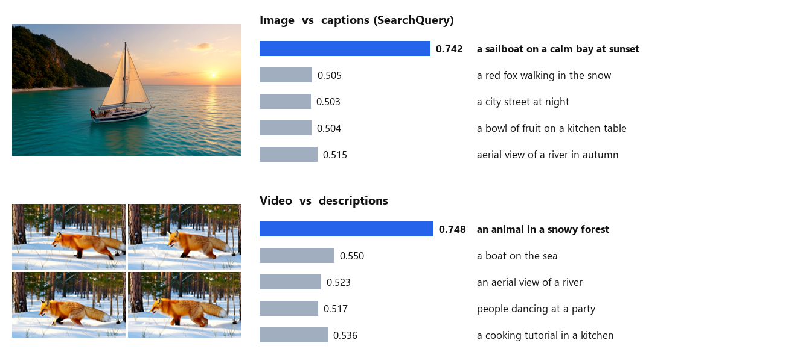

# EmbeddingGemma 2 for ComfyUI

Multimodal embeddings in ComfyUI with Google DeepMind's **EmbeddingGemma 2**
([google/embeddinggemma-2](https://huggingface.co/google/embeddinggemma-2)): text, images, video and audio are mapped into one
768-dimensional space, so they can be compared with each other. In a workflow that means, for example: pick the generated image that
fits the prompt best, sort video frames by a description, label an image with the closest caption, or find which clip a text
describes. Everything runs **inside the ComfyUI process** through
[sentence-transformers](https://github.com/huggingface/sentence-transformers), the usage the model card documents; the nodes never
download anything.

> **Unofficial.** This node pack is an independent integration. It is not affiliated with or endorsed by Google / Google DeepMind,
> by the sentence-transformers or Transformers projects, or by Comfy Org.
>
> 日本語の概要は [README.ja.md](README.ja.md) にあります。



*Real ComfyUI queue, shipped workflows: an image against five captions (top) and a video against five descriptions (bottom). The
image and the video were generated for this repository with Self Gradient Forcing+.*

## What it does

| Node | Purpose |
| --- | --- |
| **EmbeddingGemma 2 Loader** | Model folder from `models/embeddinggemma`, which encoders to load (all / text + image/video / text + audio / text), dtype, device, keep loaded |
| **Encode Text** | One embedding per line (or for the whole text), with the task prefix the model was trained with |
| **Encode Images** | One embedding per image of an `IMAGE` batch |
| **Encode Video** | One embedding for a `VIDEO` (frames sampled at 1 per second, at most 32, as in the official processing) |
| **Encode Audio** | One embedding per clip of an `AUDIO` input (mono, 16 kHz; the first 30 s count) |
| **Similarity** | Cosine similarity of every query against every candidate; best label, index and score of the first query |
| **Rank Images** | Sorts an image batch by similarity to a query, best first, optionally keeping the top k |
| **Unload** | Frees the model |

Embeddings are unit-length vectors (`EG2_EMBEDDINGS`, with a label per item). Every encode node can shorten them to 512, 256 or 128
dimensions (Matryoshka truncation, re-normalised, as the model card describes); only vectors of the same length can be compared.

**Tasks** (Encode Text): queries use `SearchQuery` (also for searching images, video and audio with text), `QuestionAnswering`,
`FactChecking` or `CodeRetrieval`; texts in a collection use `Document` (with an optional title); comparing like with like uses
`Classification`, `Clustering` or `SentenceSimilarity` on both sides. Images, video and audio take no prefix.

## How far it was checked

Windows 11, RTX 5090, ComfyUI v0.38.0, torch 2.14.1, transformers 5.20.1, sentence-transformers 6.1.0 (details and raw numbers in
[docs/VERIFICATION.md](docs/VERIFICATION.md)):

- **Bit-identical to the official usage.** The model card's usage (`SentenceTransformer(...)` in bfloat16, `encode` with the prompt
  names, `truncate_dim`) in a separate environment, fed directly from the files, gives exactly the same vectors as the nodes fed by
  ComfyUI's own Load Image / Load Video / Load Audio, in 18 of 18 cases: text in four task modes (English, Japanese, code), 256
  dimensions, a titled document, 6 images of different sizes, 2 videos and 4 audio clips (16 kHz and 44.1 kHz stereo).
- **Real ComfyUI queue:** the three shipped workflows give the same scores (all 6 decimals in the report) and the same frame
  order as the official usage recomputed separately.
- **Video frames:** ComfyUI decodes ordinary videos in floating point with its own chroma handling; the nodes encode exactly those
  frames. An 8-bit decode of the same file differs by about 1.3 / 255 per pixel on average, and its embedding has a cosine similarity
  of 0.9996 with the node's.
- **CPU tests and CI:** a tiny random model built from the official tokenizer, processor and configuration files runs the real
  processing on the CPU (tests compare every node with direct sentence-transformers calls), plus a real ComfyUI queue on the CPU.

**Not checked:** Linux or macOS with a GPU, AMD / Apple GPUs, other ComfyUI versions, retrieval quality against the model card's
benchmarks (the pack reproduces the official embeddings; it does not re-evaluate the model).

## Install

1. ComfyUI with the V3 node API (**v0.38.0** was used), Python 3.10+. A GPU is optional: the model has 740M parameters (2.5 GiB
   peak on the GPU in bfloat16 with all encoders); on the CPU it runs in float32, more slowly.
2. Clone this repository into `ComfyUI/custom_nodes/` and install its requirements into ComfyUI's Python:

   ```
   git clone https://github.com/hiroki-abe-58/ComfyUI-EmbeddingGemma2 custom_nodes/ComfyUI-EmbeddingGemma2
   python -m pip install -r custom_nodes/ComfyUI-EmbeddingGemma2/requirements.txt
   ```

3. Download the model (about 1.5 GB). The script pins the revision this pack was checked with and verifies every file's SHA-256:

   ```
   python custom_nodes/ComfyUI-EmbeddingGemma2/tools/download_model.py --models-dir models/embeddinggemma
   ```

   This creates `models/embeddinggemma/embeddinggemma-2/`. Another location works through `extra_model_paths.yaml` with the key
   `embeddinggemma`.

4. Restart ComfyUI and open a workflow from `workflows/gui/`: `image_captions` (labels `input/example.png`), `rank_frames` and
   `video_search` (both read `input/example.mp4`; put any video there or choose another one).

## Measured on this setup

RTX 5090, bfloat16, all encoders loaded, model resident (loading about 3 s): 6 texts 0.04 s, one image 0.06 s, a 5 s video 0.13 s,
a 4 s audio clip 0.1 s (the first call of each kind after loading is slower). Peak GPU memory 2.5 GiB.

## Notes and limits

- **Video length.** ComfyUI's video loader decodes every frame into memory before a node sees it (as float32: about 4.8 MB per
  832 x 480 frame), although only 1 frame per second (at most 32) is used. Trim or downscale long videos first.
- **Audio** is averaged to mono; rates other than 16 kHz are resampled with a polyphase filter (`scipy.signal.resample_poly`; the
  model accepts 16 kHz only, and the official usage leaves resampling to the caller). The soundtrack of a `VIDEO` is not used by
  Encode Video; take it with Get Video Components and Encode Audio.
- **Audio length.** Only the first 30 seconds of a clip affect its embedding: the official processing (transformers 5.20.1) caps
  a clip at 750 audio tokens, 25 per second (checked: a 60 s clip gives exactly the embedding of its first 30 s). The model card
  mentions minutes of audio; with this processing, cut longer audio into parts.
- **Context.** The model was trained with an 8,192-token context: an image is 280 tokens, a video frame 140 (32 frames at most),
  a second of audio 25. Text is not truncated by the official processing (a 12,000-word text becomes 12,003 tokens), so keep texts
  within the context.
- **dtype.** `auto` uses bfloat16 on GPUs that support it, otherwise float32. float16 is not offered: the model overflows in float16
  (model card).
- **Dependencies:** sentence-transformers (with scikit-learn and SciPy) and transformers 5.19 or later.

## Licenses

- This node pack: **MIT** ([LICENSE](LICENSE)). It contains no third-party code.
- The model (not included; downloaded only by `tools/download_model.py`): `google/embeddinggemma-2`, **Apache-2.0** according to
  its model card, which also says deployments must adhere to the
  [Gemma Prohibited Use Policy](https://ai.google.dev/gemma/prohibited_use_policy). See [NOTICE](NOTICE).

## Development

```
python -m pip install pytest ruff
python tools/download_model.py --models-dir refs/embeddinggemma --no-weights       # official tokenizer and configs only
EG2_COMFYUI_DIR=<ComfyUI checkout> EG2_REFERENCE_FILES=refs/embeddinggemma/embeddinggemma-2 python -m pytest tests
python scripts/ci_queue_check.py --comfyui <ComfyUI checkout> --reference refs/embeddinggemma/embeddinggemma-2
python scripts/run_parity.py --comfyui <ComfyUI checkout> --model <models/embeddinggemma/embeddinggemma-2> --media <folder> --out pack.npz
```
